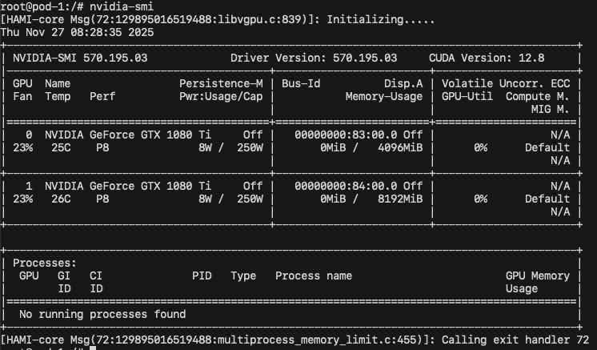

# HAMi DRA Driver

## Overview

DRA is a Kubernetes feature that lets you request and share resources among Pods, it provides a flexible way for requesting, configuring, and sharing specialized devices like GPUs. To learn more about DRA in general, good starting points are: [Kubernetes docs](https://kubernetes.io/docs/concepts/scheduling-eviction/dynamic-resource-allocation/), [Kubernetes blog](https://kubernetes.io/blog/2025/05/01/kubernetes-v1-33-dra-updates/).

The HAMi DRA Driver brings the support of DRA for [HAMi-Core](https://github.com/Project-HAMi/HAMi-core)(the in-container GPU resource controller), it might be the first open source DRA Driver for NVIDIA GPU with [DRA Consumable Capacity](https://github.com/kubernetes/enhancements/tree/master/keps/sig-scheduling/5075-dra-consumable-capacity) feature enabled.

## Installation

### Prerequisites

The list of prerequisites for running the DRA Driver for HAMi-Core is described below
- NVIDIA drivers >= 440
- nvidia-docker version > 2.0
- default runtime configured as nvidia for containerd/docker/cri-o container runtime
  - `accept-nvidia-visible-devices-as-volume-mounts` option should be set to `true` for NVIDIA Container Runtime
- Kubernetes version >= 1.34 with DRA Consumable Capacity feature enabled
- glibc >= 2.17 & glibc < 2.30
- kernel version >= 3.10


Please check the [DaemonSet configuration](demo/yaml/ds.yaml) in the demo/yaml directory. We are working on a Helm Chart for this DRA Driver, it will be available in the near future.

## Demo

```yaml
apiVersion: resource.k8s.io/v1
kind: ResourceClaim
...
spec:
  devices:
    requests:
    - name: double-gpu-0-0
      exactly:
        ...
        capacity:
          requests:
            cores: 30
            memory: "4Gi"
    - name: double-gpu-0-1
      exactly:
        ...
        capacity:
          requests:
            cores: 60
            memory: "8Gi"
```


Please refer to the [demo.md](demo/demo.md) for more information.

## vGPUMonitor compatibility

HAMi-Core preparation adds `hami.io/vgpu-node=<nodeName>` to the reserving Pod
so that upstream vGPUMonitor can discover it through its legacy metric selector.
This applies even when the optional monitor sidecar is disabled. The Helm chart
grants Pod `patch` permission in addition to `get/list/watch`; externally managed
RBAC must grant the same permissions before upgrading the driver.

Only that label is patched, with Pod UID and resource-version guards. An
existing matching label is accepted; a conflicting label, wrong-node Pod, or
API error fails preparation before cache edits. A Pod informer cache miss
falls back to a live API lookup, validating the reserving Pod's UID and node
before resolving its claim/container mapping. If resolution still fails,
preparation returns an error so kubelet can retry; it no longer creates a
claim-scoped `unknown` cache directory. The label is retained until Pod deletion
because other claims or containers may still need it. This is legacy-monitor
compatibility, not label-independent DRA
support. The monitor still requires NVIDIA runtime library injection.

Driver startup waits at most 30 seconds for the Pod informer's initial sync.
On timeout, startup continues with live Pod lookups while the informer keeps
retrying. Process cancellation stops the informer and aborts startup; API lookup
and labeling failures still fail preparation rather than bypassing monitoring.

Workloads previously prepared with an `unknown` cache are not migrated
automatically; recreate affected workloads through normal cleanup/preparation.

Preparation writes a `.claim-<claimUID>` ownership marker before CUDA starts;
HAMi-Core remains responsible for creating the actual `.cache` file. Unprepare
uses the marker to remove owned directories even if the workload never initializes
CUDA, the Pod has been deleted, or the driver has restarted. Explicit cleanup
also handles partially prepared claims. Older directories with the claim's
`.cache` file remain supported. Empty directories without either ownership marker
or claim cache are not deleted blindly; pre-existing unmarked orphans cannot be
attributed safely. Cache setup and ownership inspection failures are returned
as errors rather than reported as successful preparation/cleanup.

## Building the image with vGPUMonitor

`make build` and `make cmds` build this repository's Go code only. `make image`
packages the driver, HAMi-Core and upstream vGPUMonitor together. By default it
builds the monitor from HAMi's development branch, named `master` upstream:

```bash
make image
# For a repeatable build, supply the full HAMi commit SHA:
make image HAMI_VGPUMONITOR_REF=<HAMi-commit-SHA>
```

The monitor uses the target architecture's CGO cross-compiler and Go's automatic
toolchain selection to honor upstream's `go.mod`. Its source revision is logged
during the build and embedded in `vGPUmonitor version`. A moving branch is not
a reproducible dependency; pin its commit when recording test/release artifacts.
The final image executes `vGPUmonitor version` as a packaging smoke test; this
does not replace GPU-runtime integration testing.

After HAMi v2.11.0 is released and verified, switch to copying its monitor binary:

```bash
make image HAMI_VGPUMONITOR_SOURCE=image \
  HAMI_VGPUMONITOR_IMAGE=projecthami/hami:v2.11.0
```

Image mode requires a compatible image containing `/k8s-vgpu/bin/vGPUmonitor`
for every requested platform. HAMi v2.9.0 is not supported. Prefer a verified
image digest for reproducibility.

Both GitHub publishing workflows accept `monitor_source`, `monitor_ref` and
`monitor_image` dispatch inputs, with corresponding repository-variable fallbacks
`HAMI_VGPUMONITOR_SOURCE`, `HAMI_VGPUMONITOR_REF` and `HAMI_VGPUMONITOR_IMAGE`.
Defaults are source mode and `master`; image mode must specify the image. This
allows the same future release-image switch without editing workflow code.
PR CI also builds the selected monitor packaging stage for amd64 and arm64
without publishing it, and installs Helm before running the chart tests.

## Contributing

Contributions require a Developer Certificate of Origin (DCO, see [CONTRIBUTING.md](https://github.com/Project-HAMi/HAMi/blob/master/CONTRIBUTING.md).

## Support

Please open an issue on the GitHub project for questions and for reporting problems.
Your feedback is appreciated!
